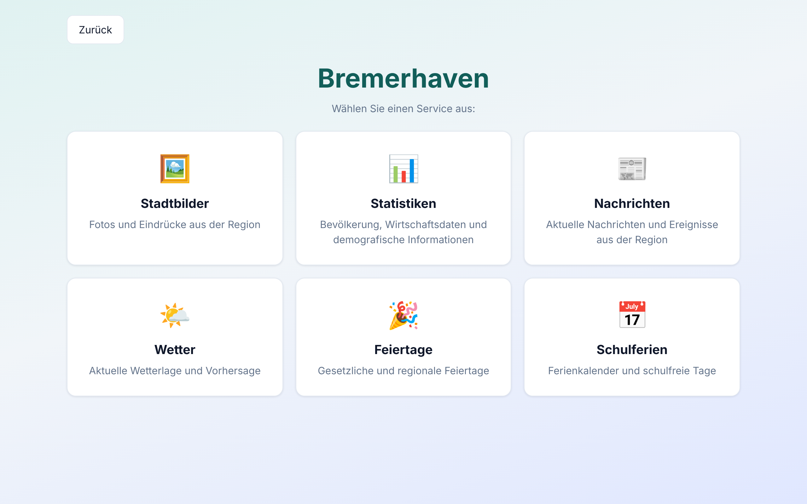
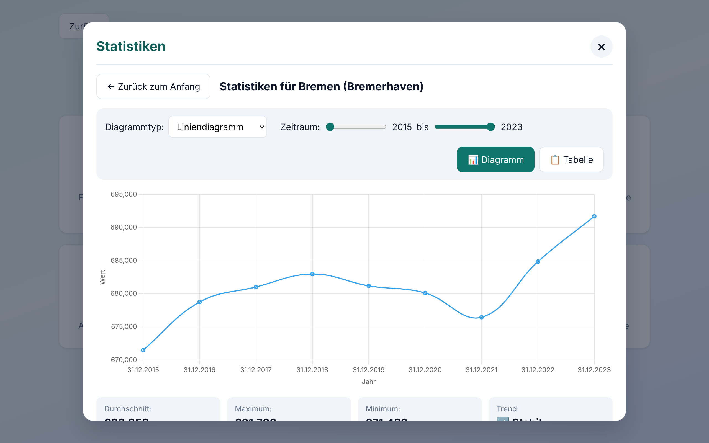
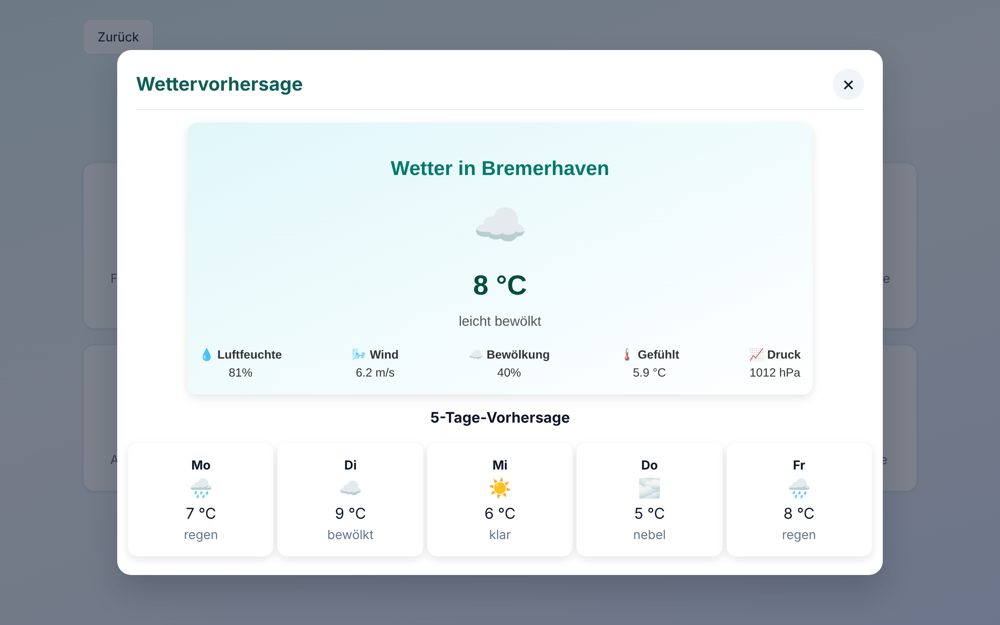
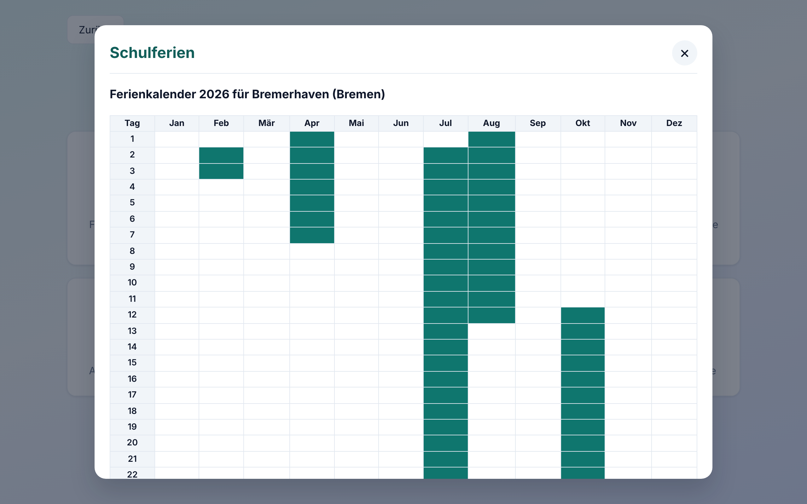

# Stadt Services

Eine Webanwendung, die zu einer deutschen Stadt oder einem Landkreis Informationen aus mehreren öffentlichen Schnittstellen (APIs) sammelt und anzeigt: Bilder, Statistiken, Nachrichten, Wetter, Feiertage und Schulferien.

Das Projekt ist im Informatikstudium an der Hochschule Bremerhaven entstanden. Ziel war, mehrere fremde APIs in einer Anwendung zu verbinden.



| Statistik | Wetter | Schulferien |
|-----------|--------|-------------|
|  |  |  |

Die Screenshots zeigen die echte Oberfläche mit Beispieldaten.

## Funktionen

| Dienst       | Was angezeigt wird                                                  | Datenquelle |
|--------------|---------------------------------------------------------------------|-------------|
| Stadtbilder  | Fotogalerie zur gewählten Stadt                                     | [Unsplash](https://unsplash.com/developers) |
| Statistiken  | Bevölkerung, Geburten, Sterbefälle, Eheschließungen als Diagramme   | [GENESIS-Online](https://www-genesis.destatis.de) (Statistisches Bundesamt) |
| Nachrichten  | Aktuelle Artikel zur Stadt                                          | [GNews](https://gnews.io) |
| Wetter       | Aktuelles Wetter und 5-Tage-Vorhersage                              | [OpenWeatherMap](https://openweathermap.org/api) |
| Feiertage    | Jahreskalender mit gesetzlichen Feiertagen                          | [Nager.Date](https://date.nager.at) |
| Schulferien  | Jahreskalender mit den Ferien des Bundeslands                       | [ferien-api.de](https://ferien-api.maxleistner.de) |

Zu welcher Stadt welches Bundesland gehört, ermittelt die Anwendung über [OpenPLZ API](https://www.openplzapi.org). Die Diagramme zeichnet [Chart.js](https://www.chartjs.org).

## Aufbau

```
Browser (index.html)
   │
   ├── direkt ──────────────► Unsplash, GNews, OpenWeatherMap,
   │                          Nager.Date, ferien-api, OpenPLZ
   │
   └── genesis-statistics.php ──► GENESIS-Online (Statistisches Bundesamt)
```

| Datei                    | Inhalt |
|--------------------------|--------|
| `index.html`             | Oberfläche und JavaScript: Suche, Auswahl des Dienstes, Abruf und Darstellung der Daten |
| `style.css`              | Aussehen: Farben, Karten, Overlay, Kalender, Diagramm-Bereich, mobile Ansicht |
| `landkreise.json`        | Liste der 400 kreisfreien Städte und Landkreise für die Suche |
| `genesis-statistics.php` | Kleiner Server-Teil: fragt die Statistik-API ab, wandelt die Antwort um und liefert JSON |
| `config.example.js`      | Vorlage für die API-Schlüssel im Browser |
| `config.example.php`     | Vorlage für den Zugang zur Statistik-API |

Die Statistik läuft über PHP, weil die GENESIS-API ihre Daten als Text mit Semikolons liefert. Das PHP-Skript macht daraus sauberes JSON und hält den Zugangs-Token auf dem Server, sodass er nicht im Browser sichtbar ist.

Eine Erklärung des Codes Schritt für Schritt steht in [docs/ERKLAERUNG.md](docs/ERKLAERUNG.md).

## Einrichten

Voraussetzung ist ein Webserver mit PHP (ab Version 7.4) und der Erweiterung cURL.

1. `config.example.js` kopieren, die Kopie `config.js` nennen und die Schlüssel für Unsplash, GNews und OpenWeatherMap eintragen.
2. `config.example.php` kopieren, die Kopie `config.php` nennen und den GENESIS-Token eintragen.
3. Zum Testen auf dem eigenen Rechner im Projektordner starten:

```bash
php -S localhost:8000
```

Danach `http://localhost:8000` im Browser öffnen.

`config.js` und `config.php` stehen in `.gitignore` und werden nicht hochgeladen. Alle vier Anbieter haben einen kostenlosen Zugang.

## Bekannte Einschränkungen

- Die Schlüssel in `config.js` sind für Besucher der Seite sichtbar, weil die Abfragen direkt aus dem Browser kommen. Für einen öffentlichen Betrieb sollten auch diese Abfragen über den Server laufen, so wie bei der Statistik.
- Das gesamte JavaScript steht in `index.html`. Der nächste Schritt wäre, es in einzelne Dateien pro Dienst aufzuteilen.

## Datenquelle der Ortsliste

`landkreise.json` basiert auf der Kreisliste aus dem Projekt [covid-19-germany-gae](https://github.com/jgehrcke/covid-19-germany-gae) von Jan-Philip Gehrcke (MIT-Lizenz), angepasst an den Gebietsstand von 2021 (400 Kreise).
